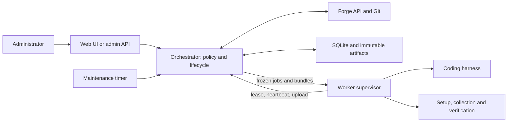

<!--
SPDX-FileCopyrightText: 2026 Slavi Pantaleev

SPDX-License-Identifier: Apache-2.0
-->

# Architecture

ArtiDezi is a maintenance controller with a separate coding worker. Deterministic code owns the
permissions, input commits, accepted output shape and forge effects. A coding model supplies the
judgment and candidate changes. It never receives the controller's publishing credentials.

One static Rust executable has separate `serve`, `worker`, configuration/schema and admin-client
commands. The orchestrator is a library independent of HTTP; the Axum server adds the API, embedded
web UI and maintenance timer. SQLite and a content-addressed artifact store hold the audit trail.
There is no external message broker, browser build pipeline or generic workflow engine.

The diagram shows responsibility, not a second transport: workers initiate HTTP requests to the
orchestrator for leases, downloads and uploads. Repository code executes on the worker. The
controller operates on Git objects and structured records without executing project tests/scripts.
Task/forge operations are serialized; UI reads and worker transport use separate local-state handles
so slow repository preparation does not block browsing or heartbeats. The single SQLite connection
is locked only for database work. See [lifecycle constraints](lifecycle.md#recovery-constraints).

## Read deeper

- [Lifecycle](lifecycle.md): manual work, immutable attempts, publication and recovery.
- [Worker contract](worker-contract.md): documents, snapshots, harness execution and validation.
- [PR discovery](pr-discovery.md): ordered rules, persistent ownership, deduplication and holds.
- [Security and storage](security-and-storage.md): what each boundary does and does not establish.
- [Project composition proposal](project-composition.md): shared metadata and explicit consumer access.
- [Web access](web-access.md): local users, project grants, attribution and future SSO.
- [GitHub integration](github-integration.md): App authentication, intake and scoped delivery.
- [Future directions](roadmap.md): unimplemented steps, kept separate from current guarantees.

For deployment grouping, start with [projects and instances](../user-guide/projects.md). A project
is a reusable permission/context scope, not a tenant or a single task. All its configured repository
snapshots participate in each job, so grouping affects access, cost and reasoning context.

## Source map

| Location | Responsibility |
| --- | --- |
| [src/main.rs](../../src/main.rs) | CLI, runtime composition and separate worker-file loading |
| [contract](../../crates/contract/src/lib.rs) | Versioned job/result/attempt/wire types, schemas and validation |
| [config](../../crates/config/src/model.rs) | YAML types; validation and frozen policy resolution |
| [store](../../crates/store/src/lib.rs) | SQLite transitions, leases, source tracking, events and artifacts |
| [git](../../crates/git/src/lib.rs) | Bare caches, bundles, workspaces, series checks and commit recreation |
| [forge](../../crates/forge/src/lib.rs) | Provider-neutral operations; Forgejo, GitHub and fake implementations |
| [harness](../../crates/harness/src/lib.rs) | Codex, Pi and scripted invocation, and harness output interpretation |
| [worker](../../crates/worker/src/lib.rs) | Lease loop, fresh workspace, recipes, collection and upload |
| [orchestrator](../../crates/orchestrator/src/lib.rs) | Jobs, discovery, ingestion, publication and reconciliation |
| [server](../../crates/server/src/lib.rs) | Authenticated transport, UI and timer |

Names in enums are not promises of runtime support. GitHub supports App-authenticated discovery and inspection, with optional reviews,
human-reviewed adaptation PRs, and explicitly configured approval/merge of unchanged updates.
Release operations remain unavailable. The worker
implements the current Codex, Pi and scripted paths, not every modeled harness/auth/sandbox mode.
Runtime behavior and Rust types are authoritative. Examples should distinguish configuration that
merely validates from a complete stack that can actually run.
