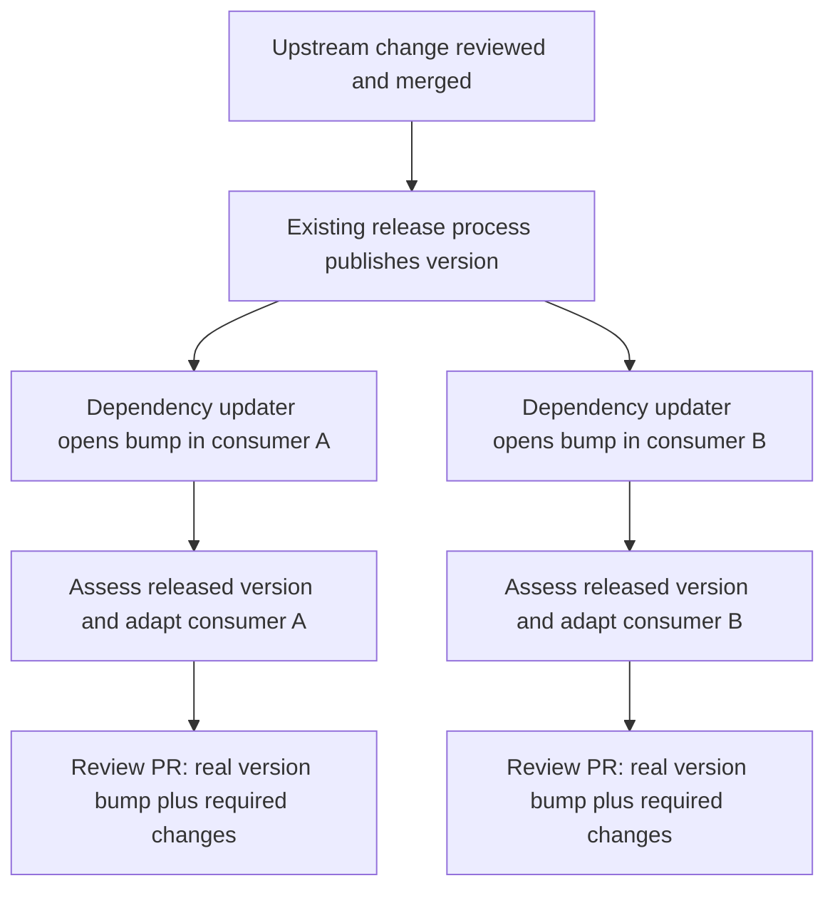

<!--
SPDX-FileCopyrightText: 2026 Slavi Pantaleev

SPDX-License-Identifier: Apache-2.0
-->

# Shared repositories and project composition — proposal

Status: design proposal, not implemented configuration. Current configuration embeds repository
settings in each project; see [the working model](../user-guide/projects.md). This proposal addresses
repeated context and coordinated adaptations without adding a generic related-project graph.

## Separate reusable facts from authority

A repository has reusable facts: forge/remote identity, branch, description and usual setup/checks.
A project's binding to that repository supplies the task role and authority: local input ID,
read-only/read-write access, optional contextual instructions and permitted changed paths.
A repository being useful context does not by itself authorize changes or activate another project.

Introduce a small instance-wide **repository catalogue** when repeated repository definitions become
a concrete configuration burden. Projects reference catalogue entries and explicitly declare access.
Keep resolution flat: no recursive project imports, permission inheritance, implicit reverse-dependency search,
transitive scope expansion or automatic task fan-out. The worker can still receive the existing
fully resolved repository list, so reuse need not add a worker-side abstraction.

The exact YAML/API naming and migration path must be settled with implementation. Preserve current
inline configuration or provide an explicit migration; reject conflicting identities and unsupported
combinations. Do not make arbitrary project-policy inheritance part of this change. Profiles and
worker pools are already reusable definitions.

## Concrete project shapes

| Project | Automatic PR source | Potential writable targets | Read-only context |
| --- | --- | --- | --- |
| Shared library | Library repository | Library; selected applications only if explicitly enabled | Relevant consumer code and interface examples |
| Application or service | Application repository | Application; deployment repository only if explicitly enabled | Relevant libraries and API definitions |
| Deployment configuration | Deployment repository | Deployment source | Selected service implementations and configuration examples |
| Monorepo component | Monorepo | Monorepo, with allowed paths for the intended change | Selected external dependencies |

For versioned dependencies, prefer an upstream project with read-only consumer context and separate
downstream projects activated after a real release. The upstream agent can investigate likely consumer
adaptations and record a migration note before release. Shared definitions still remove repeated
metadata; they do not require one task to publish every repository in the dependency chain.

Explicit writable consumers remain useful when early coordinated candidate preparation is wanted.
That is an optional preparation mode, not a guarantee that all proposals are ready to merge together.
The consumer projects own discovery of their PRs; an upstream project that includes them as inputs
still watches only its own source repository. Manual publication can create one proposal per
changed writable repository; discovered tasks retain candidates in dry-run mode or publish them when enabled.

Modules within a monorepo do not each require a separate ArtiDezi project. Select their checks and
allowed paths as appropriate; current discovery watches repositories and target branches, not paths.
Application source, a separately maintained deployment module and an environment's integration
configuration can live in separate repositories. Include each when a workflow needs to change them
together; similarity of names does not establish that relationship.

## One task, explicit candidate set

For example, a shared library update could change an API used by two applications:

1. Freeze the library's actual source PR and the current consumer bases. Include the needed interface
   examples; do not clone every repository in the organization.
2. Ask the agent to inspect both configured consumers and prepare necessary compatibility changes.
   It may leave either consumer unchanged. All permitted targets are explicit in the resolved job.
3. Run the library checks and relevant consumer integration checks against the candidate library checkout.
   Tests must consume that checkout rather than silently reinstall the old pinned release.
4. In dry-run mode, retain the candidate set/evidence. With publication enabled, publish only
   changed targets with concise source/dependency links and human review requirements.

A catalogue removes duplicated metadata, not the snapshot cost of deliberately included inputs.
Every current project repository is included in every job. Avoid dynamic model-chosen repository
expansion initially; the administrator's chosen set is the bound. If large consumer context later
proves too costly, make that a measured optimization rather than introducing a project graph first.

## Integration and release constraints

Current verification is tied to changed writable series. Merely listing an unchanged consumer does
not run its checks. A component project's trusted verification recipe can exercise both consumer trees
whenever the component changes; a future first-class project-level check should be added only if this
becomes awkward in practice. Unchanged source assessment still needs explicit reviewed-head testing
if the desired policy requires it; the current shadow path does not supply that automatically.

## Default delivery across a release boundary

The recommended default is **upstream change/release, then downstream bump plus adaptation**.
These are separate tasks because the releasable upstream result must exist before the consumer can
pin it. The dependency updater already supplies the downstream activation event.

The release artifact depends on how the consumer obtains the dependency:

| Dependency form | Required upstream result | Downstream proposal |
| --- | --- | --- |
| Git-sourced component, such as a deployment module | Published upstream tag or commit used by the consumer | Update the dependency reference and any configuration or interface usage |
| Library distributed through a package registry | Published package version available to the consumer | Update manifests/lockfiles and adapt API usage |
| Containerized application | Published versioned image for the consumer's target architectures | Update the image pin and required deployment or configuration changes |

A source tag alone is insufficient when package or image publication fails or is still running.
An updater that observes the consumed artifact provides a useful availability signal, but verification
must still use the actual version or image/digest. These examples describe release requirements;
they do not imply built-in registry integrations or artifact resolution in ArtiDezi.

Let the existing upstream release process own publication where one exists. The consumer's own
release policy is a separate concern; updating its dependency does not create the upstream artifact.

If the updater's bump needs no adaptation, assess that original PR. If it needs changes, ArtiDezi's
adaptation delivery creates a linked replacement proposal containing both the actual bump and the
integration patch. It does not overwrite the updater's branch, whose rebases could erase the fix.
Source closure/supersession needs an explicit delivery decision; do not blindly merge the original
bump or silently auto-close it merely because a candidate exists. Configure integration-sensitive
updates so updater automerge cannot bypass assessment and land an incompatible pin first.

Downstream assessment must inspect the actual released dependency corresponding to the proposed
pin, with its release notes/migration requirements. A catalogue's moving default branch is not that
identity. Existing input-ref bundles can carry a resolved release, but automatic dependency-version
to source-ref resolution and cross-task migration-note linkage are not implemented today. Add only
the narrow known-dependency handling the local experiment proves necessary; no recursive release
scheduler or model-chosen repository expansion is implied.

## Updater handoff and notification load

Some existing setups merge trusted-maintainer dependency updates automatically because the release author
is expected to have adapted every consumer in advance. Moving consumer adaptation after release
changes that responsibility. The old unconditional bypass cannot remain on updates whose integration
checks are now delegated to ArtiDezi, or it may merge the pin before assessment happens.

Migrate an explicit selected dependency set after its downstream handling is ready. For that set,
updater bumps must reach PR assessment even for a patch or revision-only version change: version shape
alone does not establish whether APIs, defaults or integration behavior changed. Dependencies
outside the migrated set retain their existing workflow and maintainer responsibility. Do not disable
working live bypass rules merely to feed a dry-run project.

The intended operational result is less human maintenance: on GitHub, routine accepted updates can merge
under explicit source-merge/check policy without a human click, while adaptations and uncertainty request
review as configured. Projects choose between dry run and publication. Coordination across a release
chain and outbound attention notifications are not implemented.

Separate this from personal notification preferences. A new forge PR need not imply an email or a
human decision. Keep successful work in the task audit/UI without gratuitous mentions or review
requests. Attention routing should be reserved for actual decisions or controller failures. Ordinary
human PR visibility remains a separate operator concern; it must not require enabling a catch-all
AI review handler, and silent automation must not be presented as implemented before it exists.

## Optional preparation before release

Early downstream candidate work can reveal problems before an upstream release, especially if it
would otherwise need another upstream fix. Keep those patches as evidence or explicitly blocked
draft proposals. Verify with candidate checkout/image overlays; after the release, a fresh downstream
task must use the real version and current target bases, reapply/review the useful preparation and
rerun checks. The initial version can pass migration notes through release notes or an explicit human
follow-up; durable automatic linkage is a separate small feature if repeated use needs it.

Never invent a release tag or use an unpublished worker commit as a fetchable dependency pin. The
publisher recreates commits, so its published SHA can differ from the worker candidate SHA. A
compatibility shim may allow independent merging before release, but that must be demonstrated.
Preparing several related proposals does not make publication, release or merging atomic. Keep
release ownership, downstream assessment and permission to merge as separate decisions.

Multiple component projects may target the same consumers. Current per-project capacity does not serialize
those shared targets globally. Initial human-reviewed use can surface competing branches/conflicts;
before stronger automatic delivery, test shared-target freshness and collision handling explicitly.
A universal dependency scheduler is not needed to make this limitation visible and bounded.

## Bounded next experiment

Exercise a synthetic shared component and two consumers through an actual local release boundary:
prepare/review the component change, publish the artifact its consumers use, let a dependency updater
such as Renovate create both real pin bumps, and assess/adapt them independently. Include a case
needing an upstream fix discovered through consumer
context, release-not-ready/failed-image behavior, unchanged consumers, source movement and competing
target changes. Test the final pinned artifacts, not only pre-release checkout overlays. Use local
Forgejo and disposable artifacts. Coordinated editing alone does not prove the full
release-to-consumer chain; validate that boundary explicitly before enabling automatic delivery.
